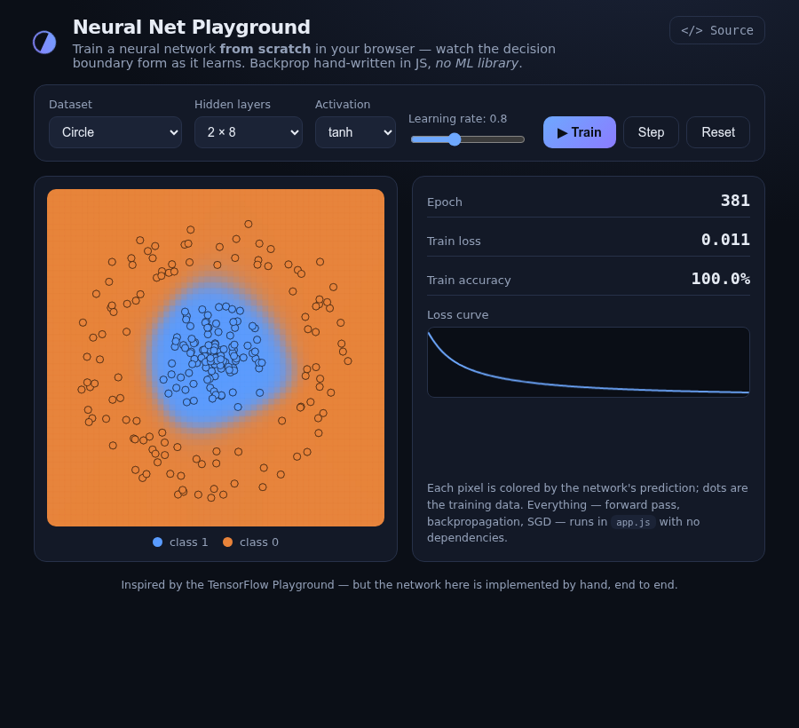

# Neural Net Playground

Train a small neural network **from scratch in your browser** and watch its decision boundary form as it learns. The forward pass, **backpropagation**, and SGD are all hand-written in plain JavaScript — *no ML library*.

> **Live demo:** https://tongchen2010.github.io/neural-net-playground/



---

## What it does

Pick a 2-D dataset (circle, XOR, two moons, spiral, gaussian), choose an architecture and activation, and press **Train**. The canvas shows:

- a **heatmap** of the network's prediction across the whole plane (the decision boundary), redrawn every frame, and
- the **training points** on top,

while loss and accuracy update live and a loss curve is plotted. You can **Step** through epochs or **Reset** the weights to watch a different random initialization converge.

## Why it's interesting

There's no TensorFlow.js here. `app.js` contains a complete multilayer perceptron:

- forward pass through arbitrary hidden layers with `tanh` / `ReLU` / `sigmoid`,
- **backpropagation** computing every gradient by hand,
- mini/full-batch **gradient descent** with a tunable learning rate,
- binary cross-entropy loss.

It runs instantly on any device — the networks are tiny — with no download, no key, and no server.

## Tested

The backprop core is unit-tested (gradient descent must actually drive loss down and reach high accuracy on linearly-separable, XOR, and circular data, for both `tanh` and `ReLU`) before any UI is involved. See the commit history / `test_net.js`.

## Controls

| Control | Effect |
|---|---|
| Dataset | Switches the toy problem (and regenerates points) |
| Hidden layers | `none` (linear) up to `16 → 8` |
| Activation | `tanh`, `ReLU`, `sigmoid` (output is always sigmoid) |
| Learning rate | Step size for gradient descent |
| Train / Step / Reset | Run continuously · one burst of epochs · re-initialize weights |

## Run locally

```bash
python3 -m http.server 8000
# open http://localhost:8000/
```

## Deploy to GitHub Pages

Push to a repo, then **Settings → Pages → Deploy from a branch → `main` / `(root)`**. The `.nojekyll` file serves everything as-is.

## License

MIT © Tong Chen
